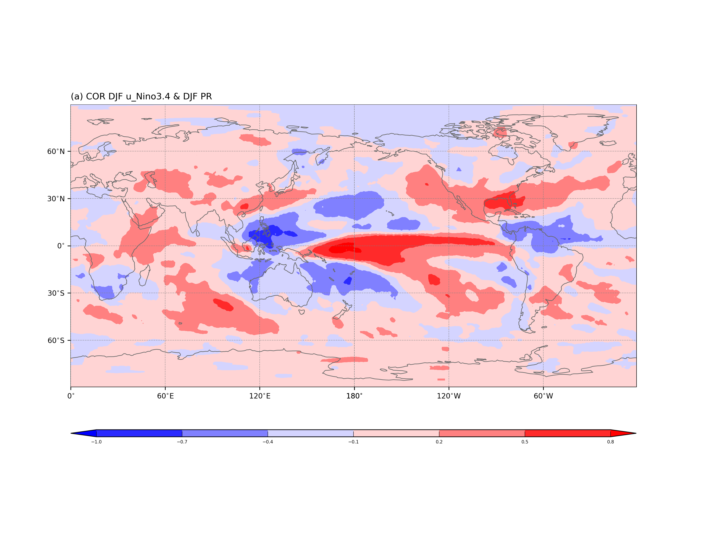
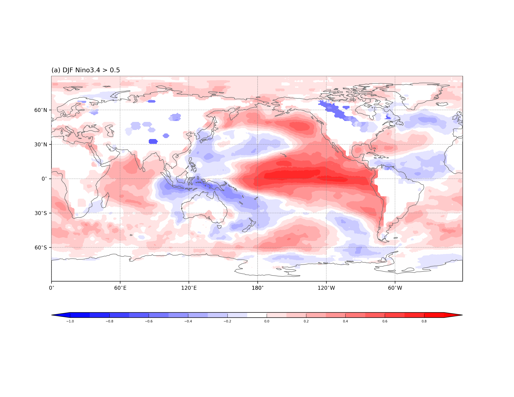
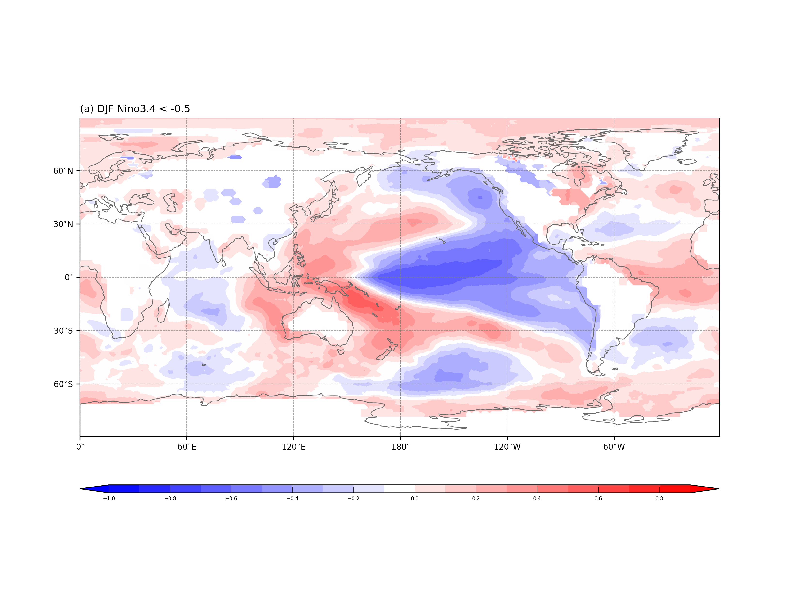
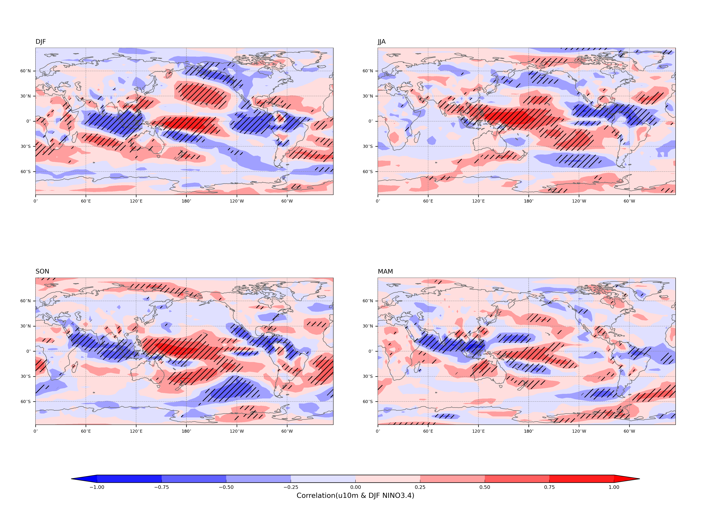
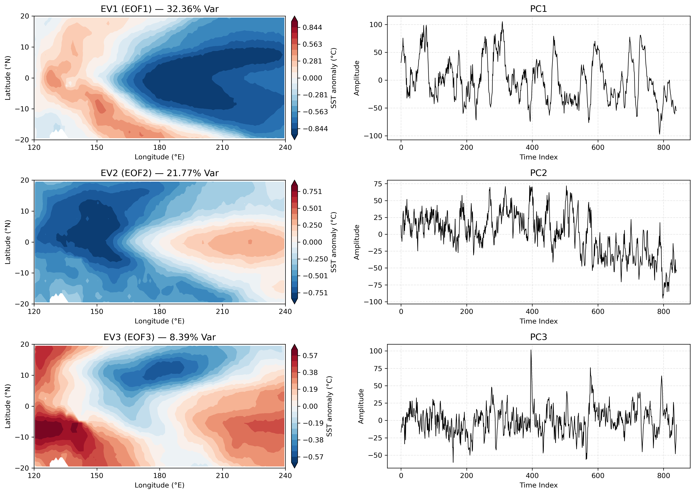
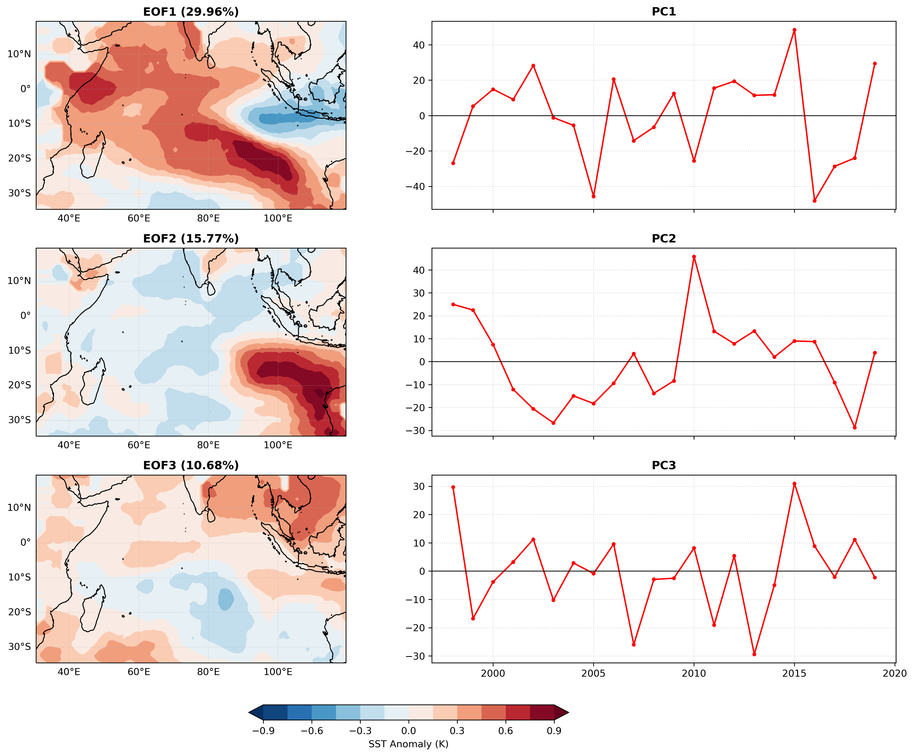

# enso-analysis-base

Basic analyses of **ENSO teleconnections** and **tropical SST variability** with ERA5.
For SST, precipitation and 10 m winds, the scripts compute correlation, regression and composite maps against the
DJF Niño3.4 index, plus EOF modes of tropical Pacific and Indian Ocean SST.

## Analyses

| Script | Analysis | Period, grid |
|---|---|---|
| `01_nino34_precip_correlation.py` | SST/precipitation anomalies, DJF Niño3.4 index, DJF Niño3.4 – DJF precipitation correlation | 1950–2019, 1° |
| `02_nino34_wind_correlation.py` | DJF Niño3.4 – DJF 10 m wind (u, v) correlation | 1993–2018, 5° |
| `03_enso_sst_composite.py` | El Niño / La Niña SST composites (DJF Niño3.4 > 0.5 / < −0.5) | 1950–2019, 1° |
| `04_pacific_sst_eof.py` | Tropical Pacific SST EOF1–3 and PCs (20°S–20°N, 120°E–120°W, monthly, SVD) | 1950–2019, 1° |
| `05_indian_ocean_ond_sst_eof.py` | Indian Ocean OND SST EOF1–3 (35°S–20°N, 30–120°E, detrended) | 1976–1997 / 1998–2019, 1° |
| `06_nino34_seasonal_u10m.py` | Correlation and regression of seasonal u10m (JJA → SON → DJF → MAM+1) on DJF Niño3.4 | 1993–2018, 5° |
| `07_seasonal_u10m_panels.py` | 4-panel correlation/regression maps from `06`, with significance hatching (t-test, N = 25, \|t\| ≥ 2.06) | 1993–2018, 5° |
| `08_precip_anomaly_timeseries.py` | Precipitation anomaly time series over 80–140°E for low (0–20°N), mid (20–40°N) and high (40–60°N) latitudes, before and after detrending | 1950–2019 |
| `09_seasonal_climatology.py` | Seasonal SST and precipitation climatologies, and their seasonal pattern correlation | 1950–2019, 1° |

**Definitions**
- **Niño3.4:** area-weighted (cos latitude) mean SST anomaly over 5°S–5°N, 170°W–120°W.
- **DJF:** December of year Y through February of year Y+1.
- **Anomalies:** relative to the monthly climatology over the full period.

## Results

### DJF Niño3.4 vs. DJF precipitation (1950–2019)
Positive correlation over the central and eastern equatorial Pacific, negative over the Maritime Continent and the
western Pacific: the classic El Niño shift of convection to the east.



### El Niño and La Niña SST composites
| El Niño (DJF Niño3.4 > 0.5) | La Niña (DJF Niño3.4 < −0.5) |
|---|---|
|  |  |

### Seasonal 10 m zonal wind vs. DJF Niño3.4 (1993–2018)
Equatorial westerly anomalies over the western and central Pacific build up from JJA through SON and peak in DJF.
Hatching marks significant correlations.



### SST EOF modes
**Tropical Pacific, monthly 1950–2019.** EOF1 (32.4%) is the ENSO pattern. EOF2 (21.8%) is a zonal west–east dipole
whose PC has a long-term trend.



**Indian Ocean, OND 1998–2019 (detrended).** EOF1 (30.0%) is a dipole: the western/central basin against the
eastern basin off Sumatra–Java. Its PC is largest in 2015. EOF2 (15.8%) is concentrated off western Australia.



## Running

Scripts read from and write to `./data/`. Run them in numeric order: later scripts use anomaly fields and indices
written by earlier ones (`01` → `03`–`05`, `06` → `07`).

Input files (ERA5 monthly SST and precipitation; daily or monthly 10 m wind, 2.5° regridded to 5°) are not included:

```
data/ERA.sst.195001_201912_1x1.nc       data/ERA.sst.195001_201912_5x5.nc
data/ERA.mtpr.195001_201912_1x1.nc
data/u10m_1993-2018_2.5deg_noleap_5x5.nc   data/v10m_1993-2018_2.5deg_noleap_5x5.nc
data/u10m_1993-2018_2.5deg_mon_5x5.nc
```

Missing values are `-9.99e+08`. Derived fields are written as GrADS binary + `.ctl`, then converted with
`cdo -f nc import_binary`.

```bash
pip install netCDF4 numpy scipy matplotlib cartopy   # and CDO (https://code.mpimet.mpg.de/projects/cdo)
python scripts/01_nino34_precip_correlation.py
```
